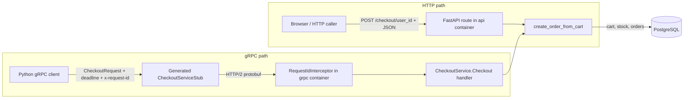
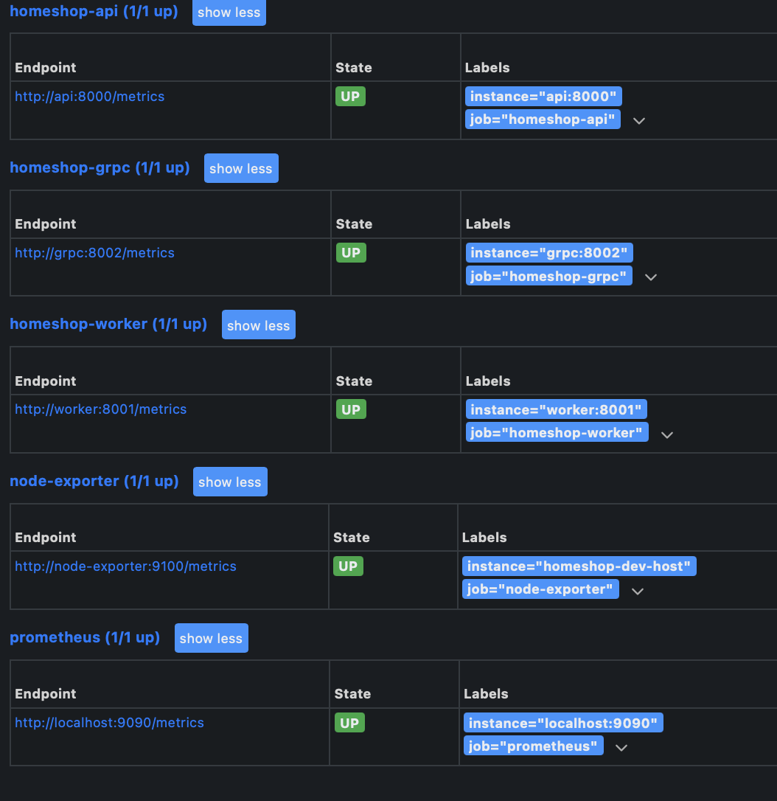
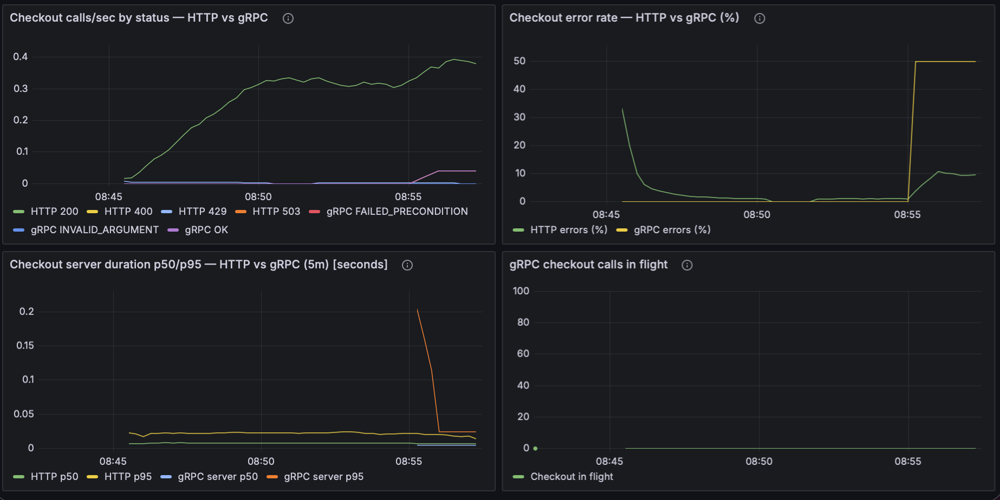

# Assignment 2 Report: HTTP APIs, gRPC, and Metrics

**Chosen user task:** checkout (`POST /checkout/{user_id}`) because its most likely to be retried, and duplicates are costly

---

## Part A: HTTP API

### A1. REST constraints

| Constraint | Meaning | Example |
|---|---|---|
| Client–server | Client and server are separate and can change independently. | The storefront, simulator and Python caller all use the FastAPI service over HTTP; logic and data stay on the server. |
| Stateless | Each request carries everything needed to handle it; there is no session. | Every request sends `X-HomeShop-User`. Caveat: the idempotency cache and rate-limit buckets live in server memory (fine for one instance). |
| Cacheable | Responses say whether caches may reuse them. | **Not demonstrated**: no `Cache-Control`/`ETag` headers. `GET /products` would be the natural candidate. |
| Layered system | A client can't tell whether it is talking to the server or to an intermediary. | **Not demonstrated**: no proxy or gateway is deployed, but adding one would need no API change. |
| Uniform interface | Consistent resource URLs, standard methods, self-describing messages. | `/products/{id}`, `/orders/{id}` with GET/POST/PATCH/DELETE; JSON bodies; one error format. |
| Code on demand (optional) | The server may send code for the client to run. | Not used. |

### A2. OpenAPI

OpenAPI is a standard, machine-readable description of an HTTP API: its paths, methods, parameters, bodies, status codes and schemas. Tools use it to generate interactive docs and clients, and to check that requests and responses match the contract.

- **Spec:** [openapi.json](openapi.json), generated by FastAPI from the route code, so its paths and inputs always match the routes. Every route documents `400`, `422` and `500` with the shared `ErrorResponse` schema. Checkout also documents `403`, `409`, `429` (with `Retry-After`), `503`, and the `Idempotency-Key` header.
- **Inspect:** Swagger UI at http://localhost:8000/docs → `POST /checkout/{user_id}` → *Try it out*.
- **Test:** `scripts/test_part_a.py` loads `/openapi.json` and checks that the live 429 response matches the documented one.

### A3. Before / after (checkout)

| Old endpoint | Problem | Change | Reason |
|---|---|---|---|
| `POST /checkout/{user_id}` | A retry after a lost response could create a second order. | `Idempotency-Key` header: repeating the key returns the original order; a concurrent repeat gets `409`. | Makes retries safe. |
| `POST /checkout/{user_id}` | No protection against retry storms. | 10 calls / 60 s per user → `429` + `Retry-After`. | Protects the checkout path and database. |
| All endpoints | Errors were `{"detail": ...}`; router/static 404/405s had a different shape. | One format everywhere: `{"error": {"code", "message", "details?"}}`. | Clients parse a single format. |

**Other endpoints.** Products, cart, orders and seller orders got only the shared error format; Pydantic already validates their bodies. `/cart/{id}/add` and `/orders/{id}/cancel` keep their action-style paths, because renaming them would break the storefront and simulator for little gain. The old `/debug/*` endpoints were replaced by `POST /debug/checkout-fault`, a demo-only fault injector.

**Callers updated:** `app/static/js/common.js` reads `error.message`, and `app/static/checkout.html` sends one `Idempotency-Key` per checkout page visit, so a double-click returns the same order.

### A4. Idempotency and rate limiting

- **Idempotency:** the first successful checkout stores `key → order_id`. Repeating the key (same user) returns that order. A repeat while the first call is still running gets `409`. If the checkout fails, the key is released so the client can retry.
- **Rate limit:** 10 checkout calls per sliding 60-second window. Each user (`X-HomeShop-User`, or the client IP without it) gets one bucket for the checkout path, and every call counts. Calls are allowed again once the oldest call in the window is more than 60 s old, and `Retry-After` gives that number of seconds. The limit is 10 rather than 3 because the A1 simulator checks out about 5 times a minute per customer.

### A5. Tests (`python3 scripts/test_part_a.py`)

```text
[PASS] valid checkout: HTTP 200 order_id=cdc02d86-06d7-4c18-9742-c4b0d1d0ce0a total_cents=750
[PASS] repeated checkout: HTTP 200 order_id=cdc02d86-06d7-4c18-9742-c4b0d1d0ce0a (same order, cart not charged twice)
[PASS] one order only: orders for pa0d190a: 1
[PASS] invalid identity: HTTP 400 {'error': {'code': 'http_error', 'message': 'User ID must be 1-32 lowercase letters, numbers, _ or -'}}
[PASS] invalid quantity: HTTP 422 Request validation failed
[PASS] empty cart: HTTP 400 {'error': {'code': 'empty_cart', 'message': 'Cart is empty'}}
[PASS] unknown route: HTTP 404 {'error': {'code': 'http_error', 'message': 'Not Found'}}
[PASS] accepted by limiter: 10 calls -> [400, 400, 400, 400, 400, 400, 400, 400, 400, 400] (400 = empty cart, i.e. reached the handler)
[PASS] rate limited: HTTP 429 Retry-After=60 body={'error': {'code': 'rate_limited', 'message': 'Too many checkout requests; please wait before retrying.', 'details': {'retry_after_seconds': 60, 'limit': 10, 'window_seconds': 60}}}
[PASS] 429 matches OpenAPI: spec documents 429 + Retry-After; body has required fields ['code', 'message']
```

### A6. Reliability caller (`python3 scripts/part_a_http_caller.py`)

The caller acts as another service calling `POST /checkout/{user_id}`. Failures are injected with `/debug/checkout-fault`, which either returns an immediate 503 or waits 3 s and then returns 503. Both happen before any business logic, so they have no side effects.

| Setting | Value |
|---|---|
| Timeout | 1.5 s per attempt |
| Retry | up to 3 attempts, backoff 0.5 s then 1.0 s; only for 502/503/504 or a timeout, never for 4xx |
| Why retrying is safe | each logical checkout sends an `Idempotency-Key`, and retries reuse it |
| Circuit breaker | opens after 2 consecutive failed calls, blocks calls for 5 s, then allows one trial call (success closes it, failure reopens it) |

```text
1) Success
  attempt 1: HTTP 200 in 0.01s
2) Repeat with the same Idempotency-Key (no duplicate order)
  attempt 1: HTTP 200 in 0.00s
  order_id=d8121b66-... same_order=True
3) Transient 503, retried with backoff
  attempt 1: HTTP 503 in 0.02s
  retrying in 0.5s (same Idempotency-Key)
  attempt 2: HTTP 200 in 0.03s
4) Timeout (server takes 3s > 1.5s), retried
  attempt 1: HTTP 599 in 1.50s          <- 599 = client-side timeout
  retrying in 0.5s (same Idempotency-Key)
  attempt 2: HTTP 200 in 0.03s
5) Server keeps failing -> breaker opens, blocks, then recovers
 call 1: 503, 503, 503 -> breaker CLOSED: failure 1/2
 call 2: 503, 503, 503 -> breaker OPEN after 2 consecutive failed call(s)
 call 3: breaker OPEN: call blocked -> not sent to the server
 call 4: breaker OPEN: call blocked -> not sent to the server
 server healthy again; waiting 5s recovery period
 call 5: breaker HALF_OPEN -> HTTP 200 -> breaker CLOSED: trial call succeeded
```

---

## Part B: gRPC service

### B1. Design

`Checkout` runs as a gRPC service in its own container (`grpc`, port 50051), and the HTTP route stays in place. Both call the same function, `app/checkout.py:create_order_from_cart()`, against the same PostgreSQL database. The gRPC server never calls the HTTP API.

- **Contract:** [grpc_service/checkout.proto](grpc_service/checkout.proto) defines a unary `Checkout(CheckoutRequest{user_id}) returns (CheckoutResponse{order_id, user_id, seller_id, status, total_cents, created_at, failure_reason})`.
- **Generation:** `python -m grpc_tools.protoc -I. --python_out=. --grpc_python_out=. grpc_service/checkout.proto` produces `checkout_pb2.py` and `checkout_pb2_grpc.py`.
- **Handler:** `grpc_service/server.py`. **Client:** `grpc_service/client.py`, which takes a user ID, sets a deadline (`--deadline`, default 3 s), sends `x-request-id` and prints the result or the error.

### B2. Call paths



### B3. Success and failure through both versions

```text
HTTP success: status=200 order_id=46b9d72e-f113-407d-aac6-cc84c3564739
HTTP failure: status=400 body={'error': {'code': 'empty_cart', 'message': 'Cart is empty'}}
gRPC success: Checkout succeeded: order_id=b6fae33c-4d7b-4b48-ae58-2a2294e4d866 status=pending total_cents=1234
gRPC failure: Checkout failed: code=FAILED_PRECONDITION details=Cart is empty
gRPC bad input: Checkout failed: code=INVALID_ARGUMENT details=user_id is required
gRPC deadline: Checkout failed: code=DEADLINE_EXCEEDED details=Deadline Exceeded
```

| Case | HTTP | gRPC | Why |
|---|---|---|---|
| Order created | `200 OK` | `OK` | Success. |
| Empty cart / out of stock | `400` | `FAILED_PRECONDITION` | The request is well-formed, but the cart is in the wrong state. |
| Missing or invalid user ID | `400` | `INVALID_ARGUMENT` | The input itself is bad. |
| Too slow | client timeout | `DEADLINE_EXCEEDED` | The client gave up; gRPC carries the deadline in the call itself. |

### B4. Logs and correlation

The client sends `x-request-id` as gRPC metadata. As in the HTTP middleware, `RequestIdInterceptor` accepts only a UUID, generating one otherwise. It puts the ID into the A1 logging context (`request_id_var`) and sends it back in the response metadata. The shared checkout code's `order_placed` event therefore carries the ID. Filebeat ships `homeshop-grpc` logs to Elasticsearch alongside the API and worker logs:

```text
request_id:"bd73ef49-ef27-40b9-a634-6a7224711f86"
{'service_name': 'homeshop-grpc', 'message': 'order_placed', ...}
{'service_name': 'homeshop-grpc', 'message': 'grpc_checkout_complete', ...}
```

Limitation: `user_id` is the A1 demo identity, not real authentication.

---

## Part C: Metrics

### C1. Audit of A1 metrics

| Area | Useful | Gap / fix |
|---|---|---|
| HTTP count and duration | Traffic and latency by route template. | Doesn't see gRPC → added gRPC metrics. 429s and unhandled 500s were never counted → **fixed**, both are now recorded. |
| Business counters, inventory Gauge | Real outcomes and stock. | The gRPC process exported a stale, duplicate `inventory_stock` → **fixed** (unregistered there). The dashboard sums order counters across both processes. |
| Worker queue and payment metrics | Async payment health. | Unchanged; doesn't include gRPC call time. |
| Scrape targets | api, worker, node-exporter. | Added `homeshop-grpc` (`grpc:8002`). |
| Logs and correlation | Request IDs in JSON logs. | Kept in logs only; never used as metric labels. |

### C2. New metrics

| Metric | Purpose | Type | Unit | Labels | Code | Query |
|---|---|---|---|---|---|---|
| `homeshop_grpc_rpc_calls_total` | Calls and errors by method and status | Counter | calls | `rpc_method`, `status` (gRPC code name) | `grpc_service/metrics.py`, `server.py` | `sum by (rpc_method, status) (rate(homeshop_grpc_rpc_calls_total[5m]))` |
| `homeshop_grpc_rpc_duration_seconds` | Server handling time and percentiles | Histogram | seconds | `rpc_method` | same | `histogram_quantile(0.95, sum(rate(homeshop_grpc_rpc_duration_seconds_bucket[5m])) by (le, rpc_method))` (use 0.50 for p50) |
| `homeshop_grpc_rpc_in_flight` | Calls currently being handled | Gauge | calls | `rpc_method` | same | `homeshop_grpc_rpc_in_flight{rpc_method="Checkout"}` |
| `http_requests_total{status="429"}` (existing metric, now complete) | Rate-limited checkouts | Counter | requests | `method`, `path`, `status` | `app/main.py` middleware | `sum(rate(http_requests_total{path="/checkout/{user_id}", status="429"}[5m]))` |

- **Error rate query:** `100 * sum(rate(homeshop_grpc_rpc_calls_total{status!="OK"}[5m])) / sum(rate(homeshop_grpc_rpc_calls_total[5m]))`. The HTTP version uses `status=~"4..|5.."`.
- **Buckets:** 1 ms, 5 ms, 10 ms, 25 ms, 50 ms, 100 ms, 250 ms, 500 ms, 1 s, 2.5 s and 5 s. These span fast local checkouts up to the multi-second range. The HTTP histogram starts at 5 ms, so its p50 is coarser.
- **Where duration is measured:** on the server, for both protocols (around the gRPC handler; in the HTTP middleware).
- **In flight rather than message size:** the messages are small and fixed-size, so their size says little. In-flight calls show concurrency and stuck calls.
- **Labels** are bounded: method, status and route template only. There are no user, order, request or trace IDs.

### C3. Dashboard evidence

To generate traffic, run `docker compose exec grpc python scripts/run_grpc_metrics_demo.py --count 4`. It makes 4 successes and 4 empty-cart failures per protocol.

**Prometheus targets.** All five jobs are UP, including `homeshop-grpc` at `grpc:8002`.



**Grafana: HTTP vs gRPC checkout** 



- **Calls/sec by status:** gRPC `OK` and `FAILED_PRECONDITION` both run at about 0.04/s. Their lines overlap because the demo sends equal numbers of successes and empty-cart failures. HTTP 200 is mostly the A1 simulator's traffic.
- **Error rate:** gRPC is 50% by design (half the demo calls are empty-cart failures). HTTP is about 10%, because the simulator's successful checkouts dilute the demo's failures.
- **Duration p50/p95:** gRPC p50 is about 1 ms. The early gRPC p95 spike (about 0.2 s) comes from the first calls after an idle period, when there are few samples in the window; it settles at about 25 ms. HTTP p50/p95 is about 5 ms / 20 ms.
- **In flight:** this stays at 0 because the unary calls finish within milliseconds, between Prometheus scrapes.

