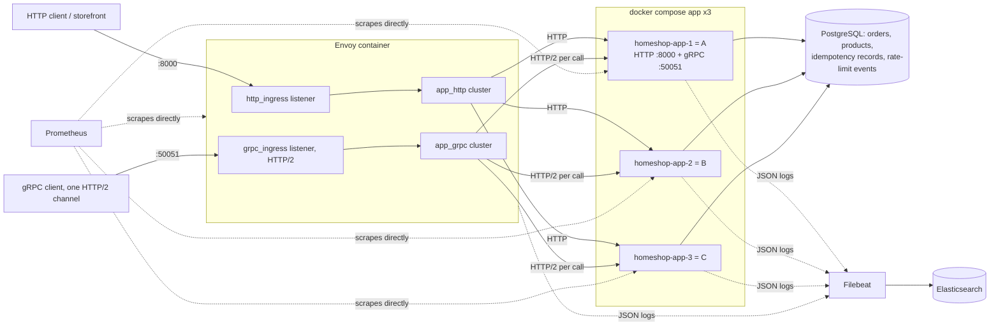
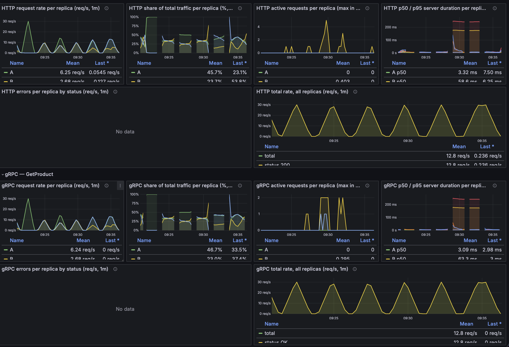
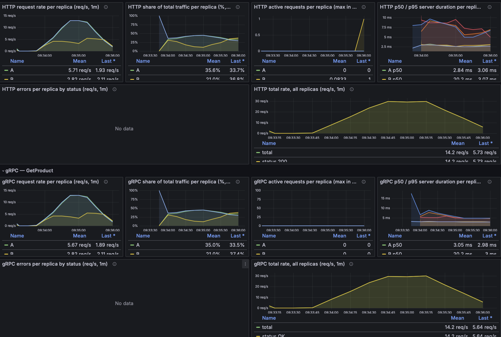
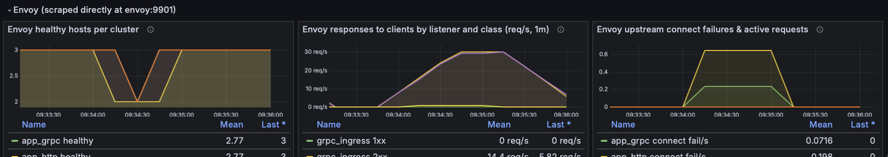

# Assignment 3 Report: Load Balancing and Observability


## 1. Architecture and shared state



- **Replicas.** `app` is one Compose service with `deploy.replicas: 3`. Each replica runs the HTTP API and the gRPC server in one process, so both interfaces share one `/metrics` endpoint and one identity. Compose names the containers `homeshop-app-1/2/3`. At startup, each replica finds which of those names resolves to its own IP and calls itself **A**, **B** or **C**.
- **Identity in logs and metrics.** Every JSON log line has a `replica` field. Every response carries an `X-Replica` header (HTTP) or `x-replica` metadata (gRPC), which Envoy writes into its access log. Prometheus scrapes each replica as its own target labelled `replica="A"`, `"B"` or `"C"`. The label has three possible values; request, trace and user IDs never appear in labels.
- **Correlation.** Envoy generates or keeps `x-request-id` and forwards it. Both the HTTP middleware and the gRPC interceptor use it as the log `request_id`, which serves as the trace ID. So one search finds the Envoy event and the replica event together (section 7).
- **Routing.** Part A starts with Envoy sending both HTTP and gRPC to **A only** (`envoy-a-only.yaml`), while B and C keep running without traffic. The policy files are generated by `envoy/render.py` and selected with `ENVOY_CONFIG`.

| State | Where it lives | Shared by all replicas? | What would go wrong if it were kept per replica |
|---|---|---|---|
| Products, carts, orders | PostgreSQL | **Yes** | Nothing; this was already shared in A1/A2. |
| Idempotency records | PostgreSQL table `idempotency_records` (moved from memory in A2) | **Yes** | A retry sent to a different replica would not find the first attempt's key and would create a second order. Under round robin, two out of three retries would miss. |
| Rate-limit counters | PostgreSQL table `rate_limit_events`, with a per-bucket advisory lock (moved from memory) | **Yes** | Each replica would count only its own share, so the real limit would be up to 3 × 10 = 30 calls a minute, and when a 429 appears would depend on routing. |
| Injected delay (`/debug/delay`) | Memory | No, **on purpose** | It makes one replica slow for Part D. |

Duplicate prevention still holds across replicas. Three attempts with the same `Idempotency-Key` landed on different replicas and returned one order:

```text
attempt 1: HTTP 200 replica=C order_id=04205e97-95e8-4164-8f29-d48be09f20e8
attempt 2: HTTP 200 replica=A order_id=04205e97-95e8-4164-8f29-d48be09f20e8
attempt 3: HTTP 200 replica=C order_id=04205e97-95e8-4164-8f29-d48be09f20e8
orders stored for user: 1
```

The A2 test suite (`scripts/test_part_a.py`) also passes through Envoy: the 11th checkout gets a `429` even though the calls were spread over three replicas.

**Test traffic.**
- **HTTP:** `GET /products/{product_id}` (from A2).
- **gRPC:** `GetProduct`, a read-only unary RPC added to the A2 `CheckoutService`. It shares the lookup code (`app/catalog.py`) and database with the HTTP route. A2's `Checkout` RPC is a write, so a fixed-rate load test would need a fresh cart for every call; the read-only twin avoids that, as the brief suggests. `Checkout` is still served and balanced by every replica.

## 2. Workload and client

`scripts/loadtest.py` runs inside the `tools` container, so it reaches Envoy over the Docker network.

- **Open loop:** call *i* is sent at *start + i/rate* without waiting for earlier responses. HTTP calls go through a pool of 256 threads; gRPC calls use non-blocking `.future()` calls on **one channel**.
- **Same workload every run:** **30 requests/s per interface for 60 s** (1,800 HTTP and 1,800 gRPC calls), run concurrently.
- **No retries or circuit breakers:** client timeout 5 s, and gRPC transparent retries are disabled with `grpc.enable_retries=0`. Envoy has no retry policy.
- **What it records:** sent, successes, failures by status, client p50/p95, and the replica that answered each call (from the `X-Replica` header or metadata), with a per-second timeline.
- **Clean traffic:** the A1 traffic simulator is stopped during runs. Runs are 75 s apart so the 1-minute dashboard windows don't overlap.

## 3. Dashboard, metrics and queries

The dashboard is **HomeShop Load Balancing (A3)** (`grafana/provisioning/dashboards/json/homeshop-lb.json`). It has one row each for HTTP and gRPC, and an Envoy row. Every rate and quantile uses a **1-minute** window. Prometheus scrapes `homeshop-app-1/2/3:8000/metrics` and `envoy:9901/stats/prometheus` **directly**, every 5 s, never through Envoy.

| Panel (per replica) | Metric (type) | Query (HTTP shown; gRPC uses `homeshop_grpc_rpc_*{rpc_method="GetProduct"}`) |
|---|---|---|
| Request rate | `http_requests_total` (Counter) | `sum by (replica) (rate(http_requests_total{method="GET", path="/products/{product_id}"}[1m]))` |
| Share of total | same | `100 * <rate above> / scalar(sum(rate(...[1m])))` |
| Active requests | `http_requests_in_flight` (Gauge, **new**; excludes `/metrics` and `/healthz`) / `homeshop_grpc_rpc_in_flight` | `max by (replica) (max_over_time(http_requests_in_flight[15s]))`. The 15 s max catches peaks between 5 s scrapes. |
| p50 / p95 | `http_request_duration_seconds` (Histogram; 1 ms and 2.5 ms buckets added) | `histogram_quantile(0.95, sum by (le, replica) (rate(..._bucket{...}[1m])))` |
| Errors by status | `http_requests_total{status!~"2.."}` / `homeshop_grpc_rpc_calls_total{status!="OK"}` | `sum by (replica, status) (rate(...[1m]))` |
| Envoy healthy hosts | `envoy_cluster_membership_healthy` | per `envoy_cluster_name` (`app_http`, `app_grpc`) |
| Envoy responses / connect failures | `envoy_http_downstream_rq_xx`, `envoy_cluster_upstream_cx_connect_fail` | `sum by (envoy_http_conn_manager_prefix, envoy_response_code_class) (rate(...[1m]))` |

Durations on the dashboard are measured at the **server**, inside each replica. Client p95 comes from the load generator, so it includes Envoy and the network.

## 4. Health checks (Part D failure test)

Active health checks are configured on both clusters in every policy file:

| Setting | Value | Probe |
|---|---|---|
| Interval (and no-traffic interval) | 2 s | HTTP: `GET /healthz` on :8000 |
| Timeout | 1 s | gRPC: standard `grpc.health.v1.Health/Check` on :50051 |
| Unhealthy threshold | 2 consecutive failures | |
| Healthy threshold | 2 consecutive successes | |

The expected time to remove a dead replica is 2 failures × 2 s, plus up to a 1 s timeout: roughly 3–5s. The expected time to re-admit it is about 2 × 2s = 4s after it is ready again. `/healthz` is deliberately cheap and is not delayed by the fault injection, so a slow replica still passes its checks.

## 5. Baselines


*Figure 1. All runs in order on the A3 dashboard (local time, UTC+5): A only, round robin, weighted 2:1:1, round robin with B delayed, least request with B delayed, failure. HTTP row on top, gRPC row below.*

### Part B: A only

| Interface | Rate (target/actual) | Sent | OK | Failed | Client p95 | A / B / C share |
|---|---|---|---|---|---|---|
| HTTP | 30 / 30.02 per s | 1800 | 1800 | 0 | 11.4 ms | 100 / 0 / 0 % |
| gRPC | 30 / 30.01 per s | 1800 | 1800 | 0 | 10.1 ms | 100 / 0 / 0 % |

As expected, A handles all the traffic. B and C are UP in Prometheus and pass Envoy's health checks, but their request-rate panels stay at 0.

### Part C: equal-weight round robin

| Interface | Sent | OK | Client p95 | A / B / C share (client) | A / B / C share (Prometheus) |
|---|---|---|---|---|---|
| HTTP | 1800 | 1800 | 9.6 ms | 33.4 / 33.3 / 33.3 % | 33.5 / 33.3 / 33.2 % |
| gRPC | 1800 | 1800 | 8.0 ms | 33.3 / 33.3 / 33.3 % | 33.4 / 33.4 / 33.2 % |

**Every replica is within 0.2 percentage points of 33.3%.** Envoy's round robin is deterministic and all three hosts were healthy, so any difference comes only from where the 60-second window starts and ends. Compared with the A-only baseline, each replica handles 10 requests/s instead of A handling 30. Client p95 fell slightly (HTTP 11.4 → 9.6 ms, gRPC 10.1 → 8.0 ms). At about 5 ms per call, even 30 requests/s keeps one replica only about 15% busy, so there was little queueing to remove. Spreading the load mainly gives headroom and fault tolerance rather than lower latency at this rate.

**gRPC is spread per call:** the client used **one** HTTP/2 connection, yet gRPC split 33/33/33. That happens because Envoy's gRPC listener is an HTTP/2 connection manager (`codec_type: HTTP2`, with an HTTP/2 upstream), not a TCP proxy. Envoy sees each call as a separate stream and routes each one independently.

## 6. Part D experiments

All three experiments start from the healthy round-robin setup and use the same 30/s × 60 s workload (the failure run lasts 90 s). Normal behaviour is restored afterwards: `scripts/run_experiments.sh` sets the delay back to 0 and returns Envoy to round robin.

### 6.1 Weighted round robin (A:B:C = 2:1:1)

- **Prediction:** shares of 50 / 25 / 25%. A handles 15 requests/s, so its latency and active requests rise a little, but it stays far from saturation.
- **Observation:**
  - **Shares:** HTTP 50.1 / 25.0 / 24.9% and gRPC 50.0 / 25.0 / 25.0%, which match the target. Prometheus and Envoy's access logs agree (section 8).
  - **Latency:** client p95 was 12.4 ms (HTTP) and 10.0 ms (gRPC), against 9.6 and 8.0 ms under round robin. Server p95 was about 7–8 ms on every replica.
  - **Active requests:** about 0 on all replicas (an occasional 1).
- **Explanation:** Envoy's weighted scheduler sends A two out of every four calls. A *higher weight does not add capacity*: A simply does twice the work on the same hardware. At about 7.5% utilisation that causes no visible queueing, so the 2–3 ms rise in client p95 is within run-to-run noise. Weighting is only worthwhile when A really has more capacity than B and C.

### 6.2 Least request versus round robin, with B delayed by 200 ms

- **Prediction:**
  - **Round robin** ignores how slow B is, so B keeps 33% and Little's law gives about 10 requests/s × 0.2 s = 2 active requests on B. Since 33% of calls are slow, client p95 should be around 200 ms.
  - **Least request** should send fewer calls to B, because B always has more requests open.
- **Observation:**

| Run | Interface | B share | B active requests (avg / max) | Client p50 | Client p95 | B server p95 | Errors |
|---|---|---|---|---|---|---|---|
| RR + delay | HTTP | 33.3% | 2.0 / 5 | 8.9 ms | 217 ms | 246 ms | 0 |
| LR + delay | HTTP | **15.9%** | **1.17** / 3 | **5.5 ms** | 208 ms | 243 ms | 0 |
| RR + delay | gRPC | 33.3% | 2.0 / 2 | 7.2 ms | 213 ms | 245 ms | 0 |
| LR + delay | gRPC | **16.1%** | **0.92** / 2 | **4.4 ms** | 206 ms | 243 ms | 0 |

- **Explanation:**
  - **Least request halved B's share** (33 → 16%), and **B's average active requests fell from about 2.0 to about 1.0**. That matches Little's law: about 4.8 requests/s × 0.2 s ≈ 1.
  - **Why B still gets 16%:** with equal weights, Envoy's least request uses "power of two choices". It picks two random hosts and sends the call to the one with fewer active requests. A and C finish in about 5 ms, so they nearly always have 0 open, and B wins only when it also has 0 open and the tie goes its way.
  - **p50 improved** (8.9 → 5.5 ms) because fewer calls waited on B.
  - **p95 barely moved** (217 → 208 ms): 16% of calls still go to B, and anything above 5% puts the 95th percentile inside B's 200 ms calls.
  - **A slow replica still passes health checks:** B stayed healthy throughout, so active health checks did nothing. Only the load-aware policy reacted.
  - Getting p95 back down would need B's share below 5%, for example with Envoy outlier detection, which ejects hosts with high latency or many errors.

### 6.3 Failure and recovery (round robin, no delay)

- **Prediction:**
  - **While Envoy notices:** B's third of the traffic (about 10 requests/s per interface) fails until Envoy marks B unhealthy, which takes about 3–5 s. So roughly 40–50 errors per interface.
  - **After removal:** A and C take 50% each.
  - **Recovery:** B returns about 4 s after it is ready, without errors, because Envoy only routes to it after health checks pass.
- **Observation** (load started at t = 0; B stopped at t = 24 s and restarted at t = 56 s):

| Time after `docker stop` | Envoy's view of B (`/clusters`, polled every 0.25 s) | Client |
|---|---|---|
| 0–4 s | still `healthy`, still routed | 503 (HTTP) / `UNAVAILABLE` (gRPC), about 10 per second |
| +3.3 s | `pending_dynamic_removal`: Docker's DNS dropped the name, but Envoy keeps the host until a health check fails | errors continue |
| **+5.0 s** | `failed_active_hc`: **removed from load balancing** | errors stop (last at t ≈ 28 s); A and C take 15 per second each |
| +8.2 s | host deleted from the cluster | 0 errors |

| Time after `docker start` | Envoy's view of B | Client |
|---|---|---|
| +1.4 s | re-added from DNS as `failed_active_hc` (waiting for checks) | no traffic to B |
| **+5.2 s** | `healthy` after 2 successful checks | B back at about 10 per second (t = 60 s), **0 errors** |

The totals for the run were: HTTP 40 failures out of 2,700 (1.48%), and gRPC 38 failures out of 2,700 (1.41%). Client p95 stayed normal, at 13.4 and 10.9 ms, because failed calls fail fast.

- **Explanation:**
  - **Removal took 5.0 s.** That fits 2 failed probes × 2 s interval + the 1 s timeout (the probes timed out with `active_hc_timeout`). Every call routed to B in that window failed, about 10 per second for about 4–5 s, which matches the roughly 40 errors.
  - **DNS didn't remove B early.** Docker's DNS dropped B's name first, but with active health checking Envoy keeps a host that disappears from DNS until it fails a check.
  - **Recovery took 5.2 s:** about 1.2 s for the container and DNS, plus 2 successful probes × 2 s. Recovery is error-free because a re-added host starts as unhealthy.



*Figure 2. Failure run: B stopped at 09:34:05 and restarted at 09:34:37 (local time). B's share dips while healthy hosts fall from 3 to 2, and Envoy records connect failures.*

## 7. Proxy and backend log examples

Searching Kibana (`homeshop-logs-*`) for one request ID returns the Envoy event together with the replica's event. These are from the A-only baseline:

**HTTP** — `request_id:"89a5e8ca-5ce5-4304-8024-6c5b5764bbb8"`
```json
{"service_name":"homeshop-envoy","message":"envoy_access","listener":"http","replica":"A","upstream_host":"172.18.0.8:8000","path":"/products/086dcc44-…","response_code":200,"duration_ms":2}
{"service_name":"homeshop-app","message":"http_request_complete","replica":"A","path":"/products/{product_id}","status_code":200,"duration_ms":1.77}
```

**gRPC** — `request_id:"c2930e75-eb10-451e-86f2-a29cc8461744"`
```json
{"service_name":"homeshop-envoy","message":"envoy_access","listener":"grpc","replica":"A","upstream_host":"172.18.0.8:50051","path":"/homeshop.v1.CheckoutService/GetProduct","response_code":200,"grpc_status":"OK","duration_ms":5}
{"service_name":"homeshop-app","message":"grpc_request_complete","replica":"A","rpc_method":"GetProduct","status":"OK"}
```

## 8. Results summary

| Run / interface | Policy and fault | Target / actual requests per s | A / B / C traffic shares | Client p95 | Error rate | Explanation |
|---|---|---|---|---|---|---|
| Baseline / HTTP | A only | 30 / 30.02 | 100 / 0 / 0 | 11.4 ms | 0% | B and C idle as designed |
| Baseline / gRPC | A only | 30 / 30.01 | 100 / 0 / 0 | 10.1 ms | 0% | same |
| RR / HTTP | Round robin | 30 / 30.02 | 33.4 / 33.3 / 33.3 | 9.6 ms | 0% | Even split; little queueing to remove |
| RR / gRPC | Round robin | 30 / 30.02 | 33.3 / 33.3 / 33.3 | 8.0 ms | 0% | Per-call HTTP/2 routing over one connection |
| WRR / HTTP | Weights 2:1:1 | 30 / 30.02 | 50.1 / 25.0 / 24.9 | 12.4 ms | 0% | Matches 50/25/25; A not saturated |
| WRR / gRPC | Weights 2:1:1 | 30 / 30.02 | 50.0 / 25.0 / 25.0 | 10.0 ms | 0% | same |
| RR+delay / HTTP | RR, B +200 ms | 30 / 30.01 | 33.4 / 33.3 / 33.3 | 217 ms | 0% | RR ignores slowness; 33% of calls slow |
| RR+delay / gRPC | RR, B +200 ms | 30 / 30.01 | 33.3 / 33.3 / 33.3 | 213 ms | 0% | same |
| LR+delay / HTTP | Least request, B +200 ms | 30 / 30.01 | 41.4 / 15.9 / 42.6 | 208 ms | 0% | B's share halved; p95 still lands in B's calls |
| LR+delay / gRPC | Least request, B +200 ms | 30 / 30.02 | 41.7 / 16.1 / 42.2 | 206 ms | 0% | same |
| Failure / HTTP | RR, B stopped 32 s | 30 / 30.01 | 39.9 / 20.2 / 39.9 | 13.4 ms | 1.48% | 5.0 s to eject, 5.2 s to re-admit |
| Failure / gRPC | RR, B stopped 32 s | 30 / 30.01 | 39.9 / 20.3 / 39.9 | 10.9 ms | 1.41% | same |

**Checked against Envoy's access logs.** For the weighted run (04:26:19–04:27:20 UTC), an Elasticsearch aggregation of Envoy's `envoy_access` events by `listener` and `replica` gives:
- **gRPC:** 1,800 calls = A 900 (50.0%), B 450 (25.0%), C 450 (25.0%)
- **HTTP:** 1,800 calls = A 902 (50.1%), B 450 (25.0%), C 448 (24.9%)

Both match the client counts exactly.

## 9. Conclusions

1. **Strategy choice.** For **both HTTP and gRPC**, I'd choose **least request**, together with active health checks.
   - With healthy, equal replicas it spreads load as evenly as round robin.
   - When one replica slowed down, it halved that replica's traffic (33 → 16%) and cut median latency by about 40%, while round robin kept sending it a full third.
   - For gRPC, the choice only works because Envoy balances per call over HTTP/2. With TCP proxying, one long-lived client connection would pin every call to one replica, whatever the policy.
   - Least request alone didn't fix p95, so in production I'd add outlier detection.
2. **A workload where I'd choose differently.**
   - **Weighted round robin:** if the replicas had different capacities (for example, A on a machine with twice the CPU), static weights would match the hardware without having to watch request counts.
   - **Consistent hashing:** if each replica kept a large in-memory product cache, hashing on `product_id` would keep each product's requests on one replica and raise the cache hit rate.
3. **If Envoy stops.** Envoy is a single point of failure. Every HTTP and gRPC call fails with connection refused even though A, B and C are healthy. Prometheus still scrapes the replicas directly, so the dashboard shows traffic dropping to zero rather than errors. **Improvement:** run two or more Envoy instances behind a floating IP or DNS with health checks (for example, keepalived, or a cloud load balancer in front), and give the Envoy container a restart policy.
