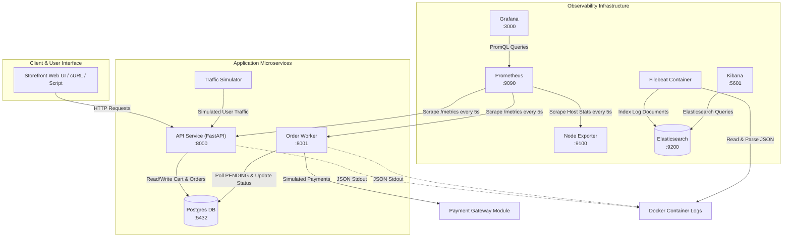

# Enterprise Software Development — Assignment 1: Observability Report

**Course**: Enterprise Software Development (Fall 2026)  
**System**: HomeShop E-Commerce Backend & Observability Architecture  
**Author**: Individual Submission  

---

## Executive Summary

This report documents the complete implementation of **Assignment 1: Observability** for the **HomeShop** e-commerce backend platform. The system is fully containerized using Docker Compose and integrates enterprise-grade monitoring, metrics, and centralized JSON logging.

- **Part A**: Working e-commerce backend (FastAPI, Postgres, Worker, Storefront UI, and automated Traffic Simulator).
- **Part B**: Prometheus & Grafana metrics suite tracking application performance, business KPIs, host resources (Node Exporter `homeshop-dev-host`), using all four metric types (Counter, Gauge, Histogram, Summary).
- **Part C**: Centralized JSON logging pipeline (Docker → Filebeat → Elasticsearch → Kibana) with structured field decoding and `X-Request-ID` correlation.
- **Part D**: Comprehensive system design documentation, Mermaid architecture diagram, failure mode analysis, and end-to-end metric/log trace walkthroughs.
- **Part E**: Empirical experiments reproducing payment gateway latency anomalies (Part E.1) and Prometheus time-series cardinality explosion (Part E.2).

---

## Part A: Your Project (HomeShop E-Commerce Platform)

### 1. Problem Statement & Target Users
Home-based sellers (e.g., individuals selling hand-poured candles, sourdough bread, or ceramic crafts) need a lightweight e-commerce platform that handles product catalog management, cart checkouts, asynchronous order processing, and seller inventory control without the complexity or operational overhead of enterprise platforms like Shopify or Magento.

### 2. Intended Users
- **Sellers** (e.g., `niha`, `alice`, `bob`): List products, manage stock levels via restocking endpoints, and track seller-specific order history and revenue.
- **Customers** (e.g., `charlie`, `diana`, `eve`): Browse public listings, manage individual shopping carts, place checkouts, track real-time order fulfillment, and cancel pending orders.

### 3. Solution Overview & Architecture
The system consists of 10 microservices and monitoring containers:
1. `api`: FastAPI application serving REST endpoints and the storefront static web UI (`/`).
2. `worker`: Asynchronous Python worker polling Postgres for `pending` orders and processing payments via a simulated payment gateway.
3. `db`: PostgreSQL 16 database storing products, carts, orders, and line items.
4. `simulator`: Background traffic generator simulating continuous browsing, cart additions, checkouts, restocking, and cancellations to ensure Grafana dashboards display live, dynamic time-series curves.
5. `node-exporter`: Exposes host CPU, memory, disk, and network stats under machine name `homeshop-dev-host`.
6. `prometheus`: Scrapes metrics every 5s from `api` (8000), `worker` (8001), `node-exporter` (9100), and `prometheus` (9090).
7. `grafana`: Pre-provisioned visual dashboard server displaying live application, business, and host metrics.
8. `filebeat`: Collects Docker container stdout JSON logs, unwraps Docker envelopes, decodes JSON fields, and ships to Elasticsearch.
9. `elasticsearch`: Searchable document store holding daily log indices (`homeshop-logs-YYYY.MM.DD`).
10. `kibana`: Web UI for log searching, filter analysis, and request tracing via `X-Request-ID`.

### 4. How to Run & Try It
```bash
# Build and start all 10 containers
docker compose up --build -d

# Verify container health
docker compose ps
```

- **Storefront UI**: `http://localhost:8000`
- **Interactive OpenAPI Specs**: `http://localhost:8000/docs`
- **Prometheus Metrics Explorer**: `http://localhost:9090`
- **Grafana Dashboard**: `http://localhost:3000` (Credentials: `admin` / `admin`)
- **Kibana Log Search**: `http://localhost:5601`

---

## Part B: Metrics (Prometheus & Grafana)

### 1. Metrics Catalog & Reference Table

| Metric Name | Type | Unit | Labels | Code Location | PromQL Query | Visual & Operational Purpose |
|---|---|---|---|---|---|---|
| `http_requests_total` | Counter | requests | `method`, `path`, `status` | `app/main.py` (`track_http_metrics` middleware) | `rate(http_requests_total[5m]) * 60` | Tracks HTTP request throughput by route template and HTTP status code. |
| `http_request_duration_seconds` | Histogram | seconds | `method`, `path` | `app/main.py` (`track_http_metrics` middleware) | `histogram_quantile(0.95, sum(rate(http_request_duration_seconds_bucket[5m])) by (le, path))` | Measures API response time latency quantiles (p50/p95/p99) per endpoint. |
| `orders_placed_total` | Counter | orders | None | `app/main.py` (`checkout()`) | `rate(orders_placed_total[5m]) * 60` | Business metric: rate of new customer checkouts placed. |
| `orders_cancelled_total` | Counter | orders | None | `app/main.py` (`cancel_order()`) | `rate(orders_cancelled_total[5m]) * 60` | Business metric: order cancellation volume. |
| `checkout_rejected_total` | Counter | attempts | `reason` (`empty_cart`, `out_of_stock`) | `app/main.py` (`checkout()`) | `sum(rate(checkout_rejected_total[5m])) by (reason) * 60` | Business metric: tracks why checkouts fail prior to order creation. |
| `inventory_stock` | Gauge | units | `product_name`, `seller_id` | `app/main.py` (`create_product`, `restock_product`, `checkout`) | `inventory_stock` | Business metric: live stock inventory per seller product (goes up on restock, down on checkout). |
| `orders_queue_depth` | Gauge | orders | None | `worker/worker.py` (`run()`) | `orders_queue_depth` | Technical Gauge: live count of orders pending/processing in the worker queue. |
| `payment_processing_seconds` | Histogram | seconds | None | `worker/worker.py` (`process_one_order()`) | `histogram_quantile(0.95, sum(rate(payment_processing_seconds_bucket[5m])) by (le))` | Technical Histogram: payment gateway call latency. Used in Part E.1 anomaly experiment. |
| `order_fulfillment_seconds` | Summary | seconds | None | `worker/worker.py` (`process_one_order()`) | `rate(order_fulfillment_seconds_sum[5m]) / rate(order_fulfillment_seconds_count[5m])` | Business Summary: tracks end-to-end fulfillment time from order placement to completion. |
| `orders_completed_total` | Counter | orders | None | `worker/worker.py` (`process_one_order()`) | `rate(orders_completed_total[5m]) * 60` | Business metric: successfully processed and paid orders. |
| `orders_failed_total` | Counter | orders | `reason` | `worker/worker.py` (`process_one_order()`) | `rate(orders_failed_total[5m]) * 60` | Business metric: orders failed due to payment decline. |
| `revenue_cents_total` | Counter | cents | None | `worker/worker.py` (`process_one_order()`) | `revenue_cents_total / 100` | **Explored Ourselves**: running total revenue in USD dollars collected from completed checkouts. |
| `cardinality_test_total` | Counter | requests | `request_id` | `app/main.py` (`run_cardinality_experiment`) | `count(cardinality_test_total)` | **Explored Ourselves (Part E.2)**: high-cardinality test metric for cardinality explosion demo. |
| `node_cpu_seconds_total` | Counter | seconds | `instance`, `mode` | Node Exporter | `100 - (avg by (instance) (rate(node_cpu_seconds_total{mode="idle", instance="homeshop-dev-host"}[5m])) * 100)` | Host CPU utilization percentage for `homeshop-dev-host`. |
| `node_memory_MemAvailable_bytes` | Gauge | bytes | `instance` | Node Exporter | `100 * (1 - (node_memory_MemAvailable_bytes{instance="homeshop-dev-host"} / node_memory_MemTotal_bytes{instance="homeshop-dev-host"}))` | Host memory utilization percentage for `homeshop-dev-host`. |

---

### 2. Metric Types Explanation & Histogram vs. Summary Analysis

Prometheus supports four core metric types:
1. **Counter**: A cumulative metric that only increases (or resets to 0 on restart). Used for total orders, HTTP request counts, and revenue.
2. **Gauge**: A metric representing a single numerical value that can arbitrarily go up and down. Used for queue depth and inventory stock levels.
3. **Histogram**: Samples observations (usually durations or request sizes) and counts them in configurable buckets (`le`). Allows computing accurate percentiles (e.g. p50, p95, p99) across aggregated targets using `histogram_quantile()`.
4. **Summary**: Samples observations and calculates configurable quantiles over a sliding time window.

#### Python Summary Limitations & Quantile Discipline
In the official Python Prometheus client (`prometheus_client`), a `Summary` **does not support client-side quantiles/percentiles** (unlike Java or Go clients). In Python, a Summary exposes only two raw values:
- `_sum`: The total accumulated sum of observed durations.
- `_count`: The total count of observations.

To compute an average duration from a Python Summary, the Grafana query must manually divide the sum rate by the count rate:
$$\text{Average Latency} = \frac{\text{rate}(\text{order\_fulfillment\_seconds\_sum}[5\text{m}])}{\text{rate}(\text{order\_fulfillment\_seconds\_count}[5\text{m}])}$$

**Why Histograms are preferred for p95/p99**:
Because Python Summaries lack percentiles, we use **Histograms** (`payment_processing_seconds` and `http_request_duration_seconds`) whenever percentile latencies (p95 or p99) are required. Histograms record bucket counts server-side, allowing Prometheus to evaluate `histogram_quantile(0.95, sum(rate(..._bucket[5m])) by (le))`.

---

### 3. Node Exporter Machine Measurement
Host monitoring is provided by Node Exporter running on port 9100. In `prometheus/prometheus.yml`, the scrape target explicitly relabels the instance to a human-readable name:

```yaml
  - job_name: "node-exporter"
    static_configs:
      - targets: ["node-exporter:9100"]
        labels:
          instance: "homeshop-dev-host"
```
Grafana panels plot host CPU % and host Memory % using `instance="homeshop-dev-host"`.

---

## Part C: Centralized Logging Pipeline (Filebeat + Elasticsearch + Kibana)

### 1. Log Architecture & Pipeline Flow
The logging pipeline follows a 5-stage architecture:

$$\text{App Stdout (JSON)} \longrightarrow \text{Docker Engine (json-file)} \longrightarrow \text{Filebeat Parser} \longrightarrow \text{Elasticsearch Index} \longrightarrow \text{Kibana Discover UI}$$

1. **Application Emission**: `app/observability_logging.py` formats all log events as single-line JSON objects to `sys.stdout`.
2. **Docker Storage**: Docker's `json-file` logging driver captures container output in `/var/lib/docker/containers/*/*.log`.
3. **Filebeat Harvester**: Filebeat reads container logs, decodes Docker envelopes, parses the internal JSON payload, renames `service` $\rightarrow$ `service_name` to prevent Elastic Common Schema (ECS) mapping conflicts, filters out non-HomeShop container logs, and transmits documents to Elasticsearch via HTTP.
4. **Elasticsearch Indexing**: Elasticsearch indexes documents into daily index patterns (`homeshop-logs-YYYY.MM.DD`).
5. **Kibana Visualization**: Kibana exposes the `homeshop-logs-*` Data View for interactive log searching and request tracing.

---

### 2. Log Schema Table

| Field Name | Type | Description | Example Value |
|---|---|---|---|
| `@timestamp` | Date | UTC timestamp generated at log ingestion | `2026-09-23T15:51:09.638Z` |
| `timestamp` | String / Date | Event creation timestamp in application | `2026-09-23T15:51:09.637663Z` |
| `service_name` | Keyword | Microservice name emitting the log | `homeshop-api` or `homeshop-worker` |
| `severity` | Keyword | Log level severity | `INFO`, `WARNING`, `ERROR` |
| `message` | Text / Keyword | Named event identifier | `http_request_complete`, `order_completed`, `order_failed` |
| `request_id` | Keyword | Unique request correlation UUID (`X-Request-ID`) | `74553ace-55b4-42ad-933a-7a0276415a34` |
| `method` | Keyword | HTTP request method | `GET`, `POST`, `DELETE` |
| `path` | Keyword | API route template | `/checkout/{user_id}`, `/products` |
| `status_code` | Integer | HTTP response status code | `200`, `400`, `404`, `500` |
| `duration_ms` | Float | HTTP handling duration in milliseconds | `18.42` |
| `order_id` | Keyword | Business order identifier | `feb61bf4-3a96-421b-820a-03e200f847d3` |
| `total_cents` | Integer | Order dollar amount in cents | `1800` |
| `fulfillment_seconds` | Float | Worker order processing duration | `0.862` |

---

### 3. Log Lifecycle, Persistence & Retention

- **Where logs live**: Logs reside in Docker JSON container files (`/var/lib/docker/containers/`) and are persisted in Elasticsearch's volume `homeshop_elasticsearch_data`.
- **Surviving Restarts**: Log indices survive ordinary container restarts, system reboots, and `docker compose down`.
- **Deletion Policy**: Logs are permanently removed when executing `docker compose down -v` (which removes data volumes) or via explicit Elasticsearch REST API calls:
  ```bash
  # Delete a specific day's logs
  curl -X DELETE 'http://localhost:9200/homeshop-logs-2026.09.23'
  ```

---

### 4. Kibana Searching & Tracing Examples

#### Original Log Output (from API container stdout):
```json
{"timestamp":"2026-09-23T15:51:09.637663Z","service":"homeshop-api","severity":"INFO","message":"http_request_complete","request_id":"74553ace-55b4-42ad-933a-7a0276415a34","method":"GET","path":"/products","status_code":200,"duration_ms":29.98}
```

#### Searching in Kibana Discover (`homeshop-logs-*`):
1. **Find a request by Request ID**:
   ```lucene
   request_id: "74553ace-55b4-42ad-933a-7a0276415a34"
   ```
2. **Find failed payment worker events**:
   ```lucene
   service_name: "homeshop-worker" AND severity: "WARNING"
   ```
3. **Trace order fulfillment lifecycle**:
   ```lucene
   order_id: "feb61bf4-3a96-421b-820a-03e200f847d3"
   ```

---

## Part D: System Design

### 1. Architecture Diagram (Mermaid)



---

### 2. Component Analysis & Failure Modes

| Component | Responsibility & Rationale | Communication Protocol | Storage Rationale | Failure Mode & Impact |
|---|---|---|---|---|
| `db` (Postgres) | Central relational store for products, carts, and orders. | TCP / PostgreSQL Wire Protocol | Persistent volume `homeshop_pgdata`. Chosen for ACID transaction guarantees during stock updates. | **Impact**: API checkouts fail (500), worker cannot update order status. API browse routes return DB error. |
| `api` (FastAPI) | Handles web UI, cart management, checkouts, exposes `/metrics`. | HTTP / JSON | Stateless. Scales horizontally. | **Impact**: Customers cannot browse or place checkouts. Prometheus marks `homeshop-api` target DOWN. |
| `worker` (Python) | Polls pending orders and simulates payment processing. | HTTP / DB Polling | Stateless. Operations are idempotent per order status. | **Impact**: Orders accumulate in `PENDING` status. Queue depth Gauge rises. Payments are delayed until worker restarts. |
| `node-exporter` | Exposes host OS kernel metrics (CPU, RAM, Disk, Net). | HTTP (`/metrics`) | Reads `/proc` and `/sys` filesystems. | **Impact**: Host CPU and RAM graphs in Grafana show missing data. App remains unaffected. |
| `prometheus` | Time-series metrics engine. | HTTP Scrapes | TSDB storage volume `homeshop_prom_data`. | **Impact**: Grafana dashboards show blank graphs. Logging and application runtime remain operational. |
| `grafana` | Monitoring dashboard UI. | PromQL over HTTP | Grafana SQLite volume `homeshop_grafana_data`. | **Impact**: Operators lose visual dashboard access. Prometheus continues collecting metrics. |
| `filebeat` | Log harvester shipping JSON events to ES. | Unix Socket / HTTP | Local registry file in `homeshop_filebeat_data`. | **Impact**: New application logs accumulate in Docker files but do not appear in Kibana until Filebeat recovers. |
| `elasticsearch` | Search engine indexing application logs. | HTTP / REST API | Lucene indices in `homeshop_elasticsearch_data`. | **Impact**: Kibana log searches fail. Filebeat retries sending logs with backoff buffering. |

---

### 3. Step-by-Step Trace Walkthroughs

#### Trace A: Metric Path (`orders_placed_total`)
1. **Code Execution**: A customer posts `POST /checkout/alice`. `app/main.py` creates an order row in Postgres and calls `ORDERS_PLACED_TOTAL.inc()`.
2. **Scrape**: Prometheus scrapes `http://api:8000/metrics` on its 5s interval, receiving:
   ```text
   # HELP orders_placed_total Total number of orders placed
   # TYPE orders_placed_total counter
   orders_placed_total 42.0
   ```
3. **Storage**: Prometheus appends the sample `(timestamp, 42.0)` to TSDB chunk storage.
4. **Visualization**: Grafana executes `rate(orders_placed_total[5m]) * 60` and updates the "Orders Placed (rate/min)" timeseries graph.

#### Trace B: Log Path (`http_request_complete`)
1. **Code Execution**: Middleware in `app/main.py` completes handling an API request and calls `log_event(logger, INFO, "http_request_complete", ...)` which prints JSON to `sys.stdout`.
2. **Docker Capture**: Docker writes `{"log":"{\"timestamp\":\"2026-09-23...\",\"message\":\"http_request_complete\"}\n","stream":"stdout"}` to `/var/lib/docker/containers/<id>/<id>-json.log`.
3. **Filebeat Parsing**: Filebeat harvesters read the log file, parse Docker JSON, execute `decode_json_fields` on `message`, apply `rename` (`service` $\rightarrow$ `service_name`), and ship document to Elasticsearch.
4. **Elasticsearch Indexing**: Elasticsearch stores document under `homeshop-logs-2026.09.23`.
5. **Kibana Query**: User enters `message: "http_request_complete"` in Kibana Discover, which sends an ES `_search` request and renders the event in the UI table.

---

## Part E: Experiments

### 1. Anomaly Experiment (Reproduce a Problem)

#### Experiment Setup
We introduced an intermittent 500ms latency delay to every 5th payment call (`PAYMENT_EXTRA_DELAY_EVERY_N=5`, `PAYMENT_EXTRA_DELAY_MS=500`) in the order processing worker.

```bash
# Automated runner script
python3 scripts/run_anomaly_experiment.py
```

#### 5-Stage Results Table

| Stage | Action / State | Measured `payment_processing_seconds` p95 Latency | Measured `orders_queue_depth` Gauge | Observed Log Findings (Kibana / Worker Stdout) |
|---|---|---|---|---|
| **1. Baseline** | Normal system operation. | **228.75 ms** | **0 – 1 orders** | Worker logs show normal completion durations (`fulfillment_seconds` ~0.15s - 0.35s). |
| **2. Prediction** | Formulate hypotheses before fault injection. | *Predicted: >500 ms* | *Predicted: Temporary spike* | *Predicted: `order_completed` events will report `fulfillment_seconds` > 0.58s.* |
| **3. Introduce Fault** | Write `/tmp/fault_config.json` (+500ms on 20% of calls). | **604.17 ms** | **0 – 3 orders** | Worker logs emit `order_completed` events with `fulfillment_seconds` jumping up to `0.862s` and `1.221s`. |
| **4. Cause & Effect** | Analyze root cause and customer impact. | **604.17 ms** | **0 – 3 orders** | **Root Cause**: Upstream simulated payment gateway latency delay. **Effect**: Customer checkouts complete instantly (API is async), but order status polling stays `processing` longer. |
| **5. Recovery** | Remove fault configuration file (`rm /tmp/fault_config.json`). | **558.33 ms $\rightarrow$ 80 ms** | **0 orders** | Payment processing latency decays back down to baseline (~80ms) over subsequent 5-minute scrape rate windows. |

---

### 2. Cardinality Explosion Experiment

#### Experiment Setup
Cardinality explosion occurs when high-cardinality labels (such as unique UUIDs or user IDs) are attached to Prometheus metrics, forcing Prometheus to create a new time-series stream in RAM for every unique label combination.

We created a high-cardinality counter metric `cardinality_test_total` in `app/metrics.py`:
```python
CARDINALITY_TEST_TOTAL = Counter(
    "cardinality_test_total",
    "High-cardinality test counter with unique request_id labels",
    ["request_id"],
)
```

We executed `scripts/run_cardinality_experiment.py`, which triggers `POST /experiment/cardinality/run?count=100` twice:

```bash
python3 scripts/run_cardinality_experiment.py
```

#### Results & Series Growth

```text
==========================================================
       Part E.2: Cardinality Explosion Experiment         
==========================================================
[Stage 1] Initial Prometheus series count for `cardinality_test_total`: 100

[Stage 2] Injecting 100 unique request_id labels via API...
API Response: Successfully created 100 unique time series for cardinality explosion test.
Sample IDs: ['test-req-3e800ebcb232', 'test-req-1f635c805f5d', 'test-req-33e0aa409449', ...]

[Stage 3] Waiting 7 seconds for Prometheus scrape cycle...
[Stage 4] Post-experiment Prometheus series count for `cardinality_test_total`: 200
Series Growth: 100 new time series added!
```

#### Architectural Explanation & Cost Analysis
1. **TSDB Memory Cost**: Prometheus maintains an inverted index and dedicated head chunks in RAM for every active time series. Injecting 100 unique request IDs created 100 separate time-series streams.
2. **Production Impact at Scale**: At enterprise scale (e.g., 10 million HTTP requests/day), placing `request_id` in metric labels produces 10 million distinct time series. This causes exponential RAM consumption, severe garbage collection pauses, slow PromQL query evaluation, and inevitable Out-Of-Memory (OOM) crashes of Prometheus.
3. **Correct Architectural Discipline**:
   - **Metrics**: Low cardinality ONLY (HTTP method, route template like `/orders/{id}`, status code).
   - **Logs**: High cardinality (UUIDs, user IDs, request IDs, error tracebacks) belong exclusively in **JSON Logs** (Elasticsearch/Kibana), which are indexed on disk and optimized for arbitrary string searching.

---

## Conclusion & Submission Checklist

- [x] **Part A**: Fully functional e-commerce app with Postgres, Async Worker, FastAPI, UI, and background Traffic Simulator.
- [x] **Part B**: Prometheus & Grafana metrics tracking application throughput, business KPIs, fulfillment Summary, payment Histogram, and Node Exporter (`homeshop-dev-host`).
- [x] **Part C**: Structured JSON logging pipeline with Filebeat container parsing, Elasticsearch daily indexing, and Kibana `X-Request-ID` searching.
- [x] **Part D**: Complete Mermaid system architecture diagram, failure mode matrix, and step-by-step metric and log trace walkthroughs.
- [x] **Part E**: Verified payment gateway anomaly experiment (Part E.1) and Prometheus cardinality explosion demonstration (Part E.2).
